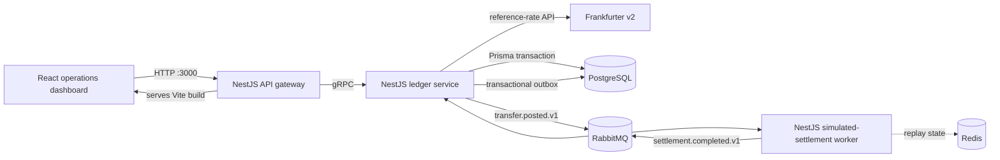
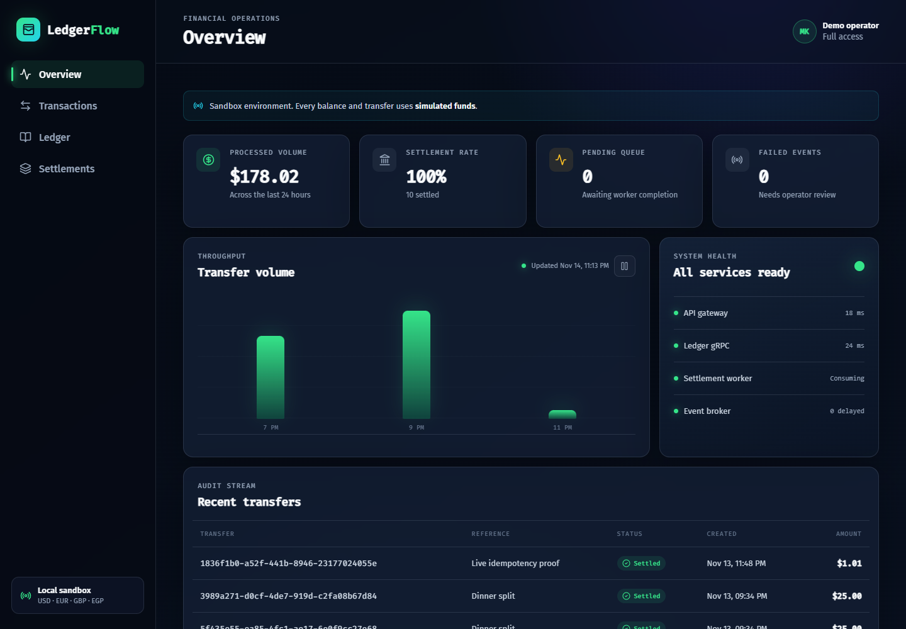
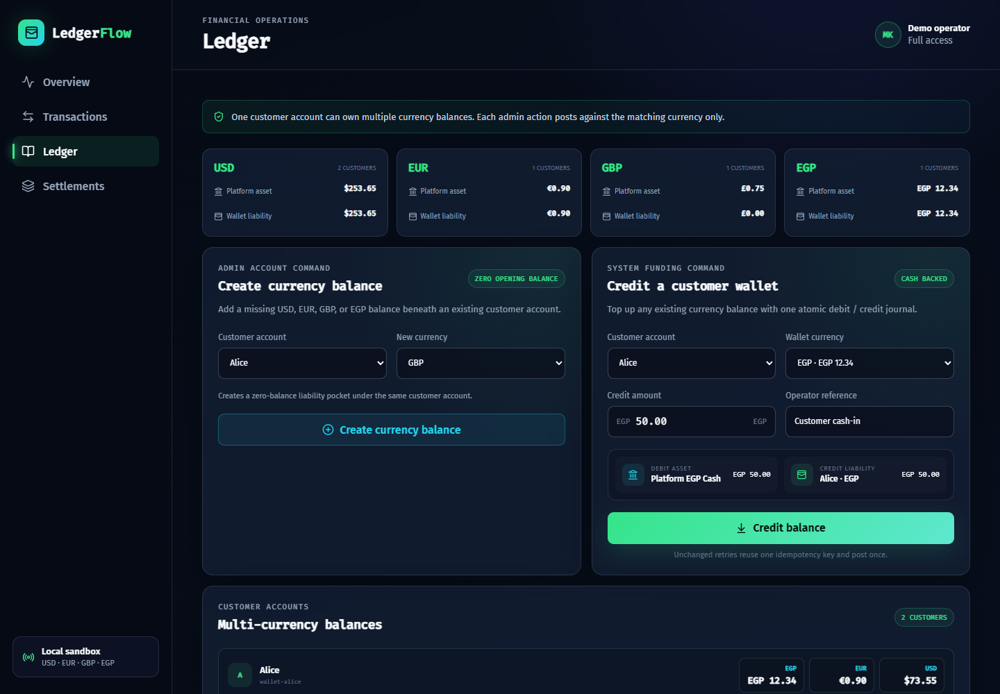

# LedgerFlow — Event-Driven Multi-Currency Ledger Simulator

LedgerFlow is a local-first financial operations simulator that demonstrates how a payment-style backend can preserve accounting correctness when commands are retried, events are delivered more than once, or an asynchronous worker restarts. It models multi-currency customer balances, funding, transfers, FX conversion, and simulated settlement.

The system combines a NestJS API gateway, a gRPC ledger service, PostgreSQL and Prisma transactions, a RabbitMQ simulated-settlement pipeline, Redis replay protection, and a React/Vite operations dashboard. **LedgerFlow never connects to a bank or payment gateway, never performs real payment settlement, and never moves real money.**

## Objective

Build a focused, executable financial operations system that demonstrates:

- immutable double-entry journals;
- atomic persistence of transfer balances, journals, idempotency records, and outbox events;
- safe sequential and concurrent command retries;
- replay-safe event publishing and idempotent consumption;
- synchronous gRPC and asynchronous RabbitMQ communication for simulated settlement;
- one customer account with multiple USD/EUR/GBP/EGP currency balances;
- admin creation and cash-backed top-up of individual currency balances;
- immutable reference-rate quotes and atomic USD/EUR/GBP/EGP conversion through the backend API;
- a live operations dashboard for transfers, funding, balances, and settlements.

## Problem

A basic CRUD transfer API can create duplicate entries or inconsistent balances when a client retries a request, two identical requests arrive concurrently, a database commit succeeds before event publication, or a worker crashes before acknowledging a message. Financial systems also need an immutable audit trail that explains every balance change.

## Solution

LedgerFlow separates four simulated financial workflows:

- **Customer balance administration** is synchronous. One customer account owns one multi-currency wallet with at most one USD, EUR, GBP, and EGP balance. Currency-specific liability accounts remain accounting records: they are inspectable for audit purposes but are never accepted as transfer or funding command inputs.
- **Wallet funding** is synchronous. For the selected currency, the ledger service resolves and debits matching Platform Cash, credits the customer's matching balance, and stores the funding record, journal, postings, balance changes, and idempotency record in one PostgreSQL transaction.
- **Wallet transfers and simulated settlement** are same-currency and cross-customer. The service resolves both internal balance accounts from public wallet IDs plus currency, rejects self-transfers or missing destination balances, and posts the transfer with its transactional outbox event. RabbitMQ then drives the simulated asynchronous settlement lifecycle.
- **Currency conversion** is synchronous. The ledger service requests a Frankfurter reference rate, validates its decimal text without floating-point arithmetic, and persists an immutable 15-minute quote. Confirmation atomically updates four accounts and stores two independently balanced currency legs plus the idempotency record.

Every money-mutating command—funding, transfer, reversal, and confirmed FX conversion—is protected by an idempotency key. PostgreSQL transaction-scoped advisory locks serialize concurrent requests using the same key before the stored request hash is checked. FX quote creation does not change balances, while duplicate currency-balance creation is prevented by a unique `(wallet, currency)` constraint and returns a conflict.

## Architecture



The ledger service is the only PostgreSQL owner. Redis is coordination data, not financial truth.

## Implemented workflows and technology alignment

| Workflow                     | Current execution path                                                                                                      | Correctness rule                                                                                                                                                   |
| ---------------------------- | --------------------------------------------------------------------------------------------------------------------------- | ------------------------------------------------------------------------------------------------------------------------------------------------------------------ |
| Load the dashboard           | React/Vite → NestJS REST API → gRPC ledger service → PostgreSQL                                                             | Financial data comes from the live API; the browser automatically uses the documented demo operator credentials.                                                   |
| Create a currency balance    | `POST /api/wallets/:walletId/balances` → gRPC → one Prisma transaction                                                      | Create one zero-value internal liability account and mapping; duplicate `(wallet, currency)` requests are rejected.                                                |
| Credit a customer wallet     | `POST /api/wallet-fundings` → gRPC → domain validation → one Prisma transaction                                             | Debit same-currency Platform Cash and credit one customer balance by the same positive minor-unit amount. Funding completes synchronously.                         |
| Quote a conversion           | `POST /api/fx/quotes` → gRPC → Frankfurter v2 JSON/CSV → exact decimal ratio → PostgreSQL                                   | Store provider, effective date, exact decimal/rational rate, input/output amounts, and a 15-minute expiry. No balance changes occur while quoting.                 |
| Confirm a conversion         | `POST /api/fx/conversions` → gRPC → domain validation → one Prisma transaction                                              | Post four account updates and two separately balanced currency legs once, using the immutable quote snapshot and an idempotency key.                               |
| Create a wallet transfer     | `POST /api/transactions` → gRPC → domain validation → one Prisma transaction                                                | Resolve the selected currency for two different customers, guard funds, then persist balances, journal, idempotency record, and outbox event atomically.           |
| Simulate transfer settlement | PostgreSQL outbox → RabbitMQ `transfer.posted.v1` → settlement worker → RabbitMQ `settlement.completed.v1` → ledger service | Use durable queues, persistent messages, deterministic result IDs, Redis replay state, PostgreSQL processed-event records, and manual acknowledgements.            |
| Retry a command              | Gateway idempotency header → PostgreSQL advisory lock → stored request hash                                                 | An unchanged retry returns the original resource. Reusing the key with a different payload is rejected. Concurrent equal retries post once.                        |
| Reverse a transfer           | `POST /api/transactions/:id/reverse` → gRPC → one Prisma transaction                                                        | Create a compensating journal, reverse the balances, and preserve the original journal. The reversal is currently an API/Swagger workflow, not a dashboard action. |
| Check service readiness      | `/health/live` and `/health/ready`                                                                                          | Liveness reports the gateway process; readiness verifies the gRPC ledger dependency.                                                                               |

## What is implemented

- One Alice customer account with USD/EUR balances and one Bob account with USD/GBP balances.
- Same-currency transfers between different customers using public wallet IDs rather than ledger account IDs.
- Admin creation of any missing USD/EUR/GBP/EGP balance and top-up of any existing balance.
- Frankfurter-backed reference-rate quotes with exact decimal/rational snapshots and 15-minute expiry.
- Atomic, idempotent four-account FX conversion with currency-tagged postings.
- Operator wallet funding backed by incoming Platform Cash, posted as `Debit Asset / Credit Liability`.
- Integer minor-unit money (`$25.00` is stored as `2500`), never floating-point ledger amounts.
- Balanced debit and credit postings for every journal.
- Immutable posting history and explicit compensating reversals.
- Request idempotency with payload-conflict detection.
- Transaction-scoped PostgreSQL advisory locks that serialize concurrent retries of one command.
- Conditional balance updates that prevent concurrent transfers from spending the same funds.
- Transactional outbox with persistent RabbitMQ messages.
- Manual acknowledgement after successful simulated-settlement event handling.
- Deterministic simulated-settlement result IDs for safe replay.
- Demo JWT authentication, operator authorization, request validation, correlation IDs, and Swagger.
- Separate liveness and dependency-readiness endpoints.
- Responsive, accessible operations dashboard with reduced-motion support.

## Screenshots

The dashboard below shows the local simulator after exercising the seeded accounts through several funding and transfer commands. No real funds or external payment rails are involved.



The Ledger page is available immediately after first startup. The seed creates the platform cash accounts, Alice and Bob customer wallets, and their initial currency balances; operators can then add another supported currency or post a cash-backed top-up.



## Technology

| Area             | Stack                                                |
| ---------------- | ---------------------------------------------------- |
| API and services | Node.js 24.11+, npm 11.6+, NestJS 12, TypeScript 5.9 |
| Data             | PostgreSQL 17, Prisma 7                              |
| Messaging        | RabbitMQ 4, Redis 8, gRPC                            |
| Frontend         | React 19, Vite 8, React Router, Lucide               |
| Quality          | Vitest, Supertest, ESLint, Prettier                  |
| Runtime          | Docker Compose                                       |

## Repository map

```text
apps/
  api-gateway/         REST, JWT, RBAC, validation, Swagger, gRPC client
  ledger-service/      accounting application service, Prisma, gRPC, outbox
  settlement-worker/   RabbitMQ consumer, Redis replay state, result publisher
  web/                 React/Vite operations dashboard served by NestJS
packages/
  contracts/           shared TypeScript types and ledger.proto
  ledger-domain/       pure money, journal, and transfer rules
docs/
  design/              product and architecture specification
  superpowers/plans/   implementation plan and verification scope
```

## Quick start with Docker

### Prerequisites

- Docker Desktop with Compose v2
- 4 GB of free memory for the local stack

From the repository root:

```bash
docker compose up -d --build
```

Open:

- Dashboard: <http://localhost:3000>
- Swagger: <http://localhost:3000/docs>
- Readiness: <http://localhost:3000/health/ready>
- RabbitMQ management: <http://localhost:15672> (`ledgerflow` / `ledgerflow`)

On first startup, the ledger container applies the checked-in Prisma migrations and runs the idempotent seed before starting gRPC. The seed creates:

- Platform Cash accounts for USD, EUR, GBP, and EGP;
- Alice with USD and EUR balances;
- Bob with USD and GBP balances.

Stable IDs and Prisma `upsert` calls make the seed safe to repeat. Restarting the stack restores missing demo records without duplicating wallets or resetting balances changed through the application. Transaction and settlement history is created only when the demo commands run, so the seed does not fabricate financial activity.

Stop the services with `docker compose down`. Add `-v` only when you intentionally want to remove local PostgreSQL and Redis data.

### Dashboard routes

| Route           | Purpose                                                                   |
| --------------- | ------------------------------------------------------------------------- |
| `/`             | Operational summary, service status, transfer volume, and recent activity |
| `/transactions` | Same-currency transfers between different customer accounts               |
| `/ledger`       | Admin currency-balance creation, top-up, and grouped customer balances    |
| `/settlements`  | Simulated asynchronous settlement history                                 |

There is intentionally no `/exchange` dashboard page. Unknown dashboard routes redirect to the overview, while FX quote and conversion operations remain available through REST and Swagger.

## Run without Docker

Infrastructure still needs PostgreSQL, RabbitMQ, and Redis. Copy the example environment and update connection strings if necessary:

```bash
cp .env.example .env
npm install
npm run db:generate
npm run db:deploy
npm run db:seed
npm run dev
```

On PowerShell, use `Copy-Item .env.example .env` instead of `cp`.

The non-Docker development command runs the Vite dashboard at <http://localhost:3000> and the NestJS gateway at <http://localhost:3001>. Vite proxies `/api`, `/docs`, and `/health` to the gateway.

`FRANKFURTER_BASE_URL` defaults to `https://api.frankfurter.dev/v2`. The provider needs no API key. LedgerFlow requests CSV so the published decimal rate can be parsed and persisted exactly; changing this URL is intended for a compatible proxy or deterministic test stub.

## Demo credentials

```text
Email:    operator@ledgerflow.local
Password: ledgerflow-demo
```

These credentials and the default JWT secret are for local simulation only.

## Demo workflow

1. Open the dashboard and confirm the **Local sandbox** indicator.
2. The local dashboard signs in with the documented demo operator account.
3. Open **Ledger** and create a missing currency balance for a customer. The new balance starts at zero under the same customer account.
4. On **Ledger**, credit any existing currency balance. Confirm that matching-currency Platform Cash and customer liability increase together and one funding record appears.
5. Open **Transactions**, select a source customer and currency, and observe that the destination lists only other customers with that currency.
6. Transfer USD from Alice to Bob. The command posts a balanced journal and pending outbox event atomically.
7. Submit the unchanged command with the same idempotency key; the original result returns without a second balance change.
8. Open **Settlements** after the worker processes the RabbitMQ event, or reload, and confirm that simulated settlement completed.
9. Use Swagger or REST to inspect journals or exercise the retained FX quote/conversion backend. There is intentionally no separate Exchange dashboard page.
10. Reuse an idempotency key with a different payload; the API rejects the conflict. Reverse a transfer through Swagger or REST to create a compensating journal.

The dashboard reads financial state from the live NestJS API when it loads and after dashboard mutations. It does not currently poll in the background, so asynchronous settlement changes require a reload.

## API example

Get a token:

```bash
curl -X POST http://localhost:3000/api/auth/login \
  -H "Content-Type: application/json" \
  -d '{"email":"operator@ledgerflow.local","password":"ledgerflow-demo"}'
```

Create a simulated same-currency transfer after copying `accessToken` from the response:

```bash
curl -X POST http://localhost:3000/api/transactions \
  -H "Authorization: Bearer <accessToken>" \
  -H "Idempotency-Key: demo-transfer-001" \
  -H "Content-Type: application/json" \
  -d '{
    "sourceWalletId":"wallet-alice",
    "destinationWalletId":"wallet-bob",
    "amountMinor":2500,
    "currency":"USD",
    "reference":"Dinner split"
  }'
```

Create an EGP balance beneath Alice's existing customer account:

```bash
curl -X POST http://localhost:3000/api/wallets/wallet-alice/balances \
  -H "Authorization: Bearer <accessToken>" \
  -H "Content-Type: application/json" \
  -d '{"currency":"EGP"}'
```

Credit an existing customer balance from matching-currency Platform Cash:

```bash
curl -X POST http://localhost:3000/api/wallet-fundings \
  -H "Authorization: Bearer <accessToken>" \
  -H "Idempotency-Key: demo-funding-001" \
  -H "Content-Type: application/json" \
  -d '{
    "walletId":"wallet-alice",
    "amountMinor":5000,
    "currency":"USD",
    "reference":"Customer cash-in"
  }'
```

Request an immutable reference-rate quote:

```bash
curl -X POST http://localhost:3000/api/fx/quotes \
  -H "Authorization: Bearer <accessToken>" \
  -H "Content-Type: application/json" \
  -d '{"sourceCurrency":"USD","destinationCurrency":"EUR","sourceAmountMinor":2500}'
```

Confirm it after copying the returned quote `id`:

```bash
curl -X POST http://localhost:3000/api/fx/conversions \
  -H "Authorization: Bearer <accessToken>" \
  -H "Idempotency-Key: demo-fx-001" \
  -H "Content-Type: application/json" \
  -d '{"quoteId":"<quoteId>","sourceAccountId":"wallet-alice","destinationAccountId":"wallet-alice-eur","reference":"Travel money"}'
```

Important routes:

| Method     | Route                             | Purpose                           |
| ---------- | --------------------------------- | --------------------------------- |
| `POST`     | `/api/auth/login`                 | Create demo JWT                   |
| `GET`      | `/api/wallets`                    | List customer currency balances   |
| `POST`     | `/api/wallets/:walletId/balances` | Create a missing currency balance |
| `GET/POST` | `/api/transactions`               | List or create transfers          |
| `GET/POST` | `/api/wallet-fundings`            | List or credit wallets            |
| `POST`     | `/api/fx/quotes`                  | Snapshot a reference quote        |
| `GET/POST` | `/api/fx/conversions`             | List or confirm conversions       |
| `POST`     | `/api/transactions/:id/reverse`   | Create compensating reversal      |
| `GET`      | `/api/accounts`                   | List ledger accounts              |
| `GET`      | `/api/journals/:id`               | Inspect journal postings          |
| `GET`      | `/api/settlements`                | Inspect settlement state          |
| `GET`      | `/api/dashboard/summary`          | Operational metrics               |
| `GET`      | `/health/live`                    | Process liveness                  |
| `GET`      | `/health/ready`                   | Ledger dependency readiness       |

## Financial invariants

- Amounts are positive safe integers in minor units.
- Wallet transfer, funding, balance creation, and FX conversion support USD, EUR, GBP, and EGP with two minor decimals each.
- A customer has at most one balance per supported currency; ledger liability account IDs are not accepted by transfer or funding APIs.
- Transfer source and destination customer wallets must differ and both must own the selected currency.
- Every journal has at least two postings.
- Total debits must equal total credits independently for every currency represented in a journal.
- Posted journals are never edited or deleted.
- Corrections create a linked reversal journal.
- A reused idempotency key must have the same payload.
- Concurrent commands sharing one idempotency key are serialized before replay detection.
- Wallet funding resolves and debits Platform Cash in exactly the selected currency and credits the matching customer liability atomically.
- Wallet funding is synchronous and does not enter the RabbitMQ settlement pipeline.
- An FX quote never changes balances and expires after 15 minutes.
- Provider decimal text is converted to a reduced integer ratio; output minor units use integer half-up rounding.
- FX journals balance each currency independently: source wallet debit/source cash credit, then destination cash debit/destination wallet credit.
- FX conversion is synchronous and does not enter the RabbitMQ settlement pipeline.
- Consumer acknowledgement happens only after successful processing.

## Quality checks

```bash
npm run format:check
npm run lint
npm run typecheck
npm test
npm run build
npm audit --audit-level=high
```

Run the same complete gate with `npm run verify`.

Run one workspace while developing:

```bash
npm test -w @ledgerflow/ledger-domain
npm test -w @ledgerflow/ledger-service
npm test -w @ledgerflow/api-gateway
npm test -w @ledgerflow/web
```

## Observability and operations

- `x-correlation-id` is accepted or generated by the gateway and returned to the caller.
- Outbox rows record publication status and attempt count.
- Simulated-settlement rows record event ID, attempt count, status, and completion time.
- RabbitMQ messages are persistent and queues are durable.
- Readiness fails when gRPC is unavailable while liveness stays available.

## Security and safety

LedgerFlow is an educational simulator, not a PCI-compliant payment system. Do not connect it to real accounts, store customer secrets, or reuse the demo credentials. Production work would require managed secrets, TLS/mTLS, rate limits, audited authorization, encrypted backups, KYC/AML controls, fraud monitoring, data retention rules, and independent security review.

## Limitations

- Frankfurter rates are reference data, not trading-grade executable prices; there are no spreads, fees, tax, interest, or external bank/processor settlement.
- FX supports only USD, EUR, GBP, and EGP, all modeled with two decimal minor units.
- One PostgreSQL owner and one settlement worker instance in the default Docker Compose topology.
- Redis replay state is retained for seven days.
- No real payment gateway, bank integration, cloud deployment, or Kubernetes.
- The dashboard fetches live financial data but does not poll for asynchronous updates.
- FX quote/conversion endpoints remain available through REST and Swagger, but the dashboard intentionally has no Exchange page.
- Dashboard service-latency labels and the pause/resume control are presentation-only; use `/health/live` and `/health/ready` for actual health checks.
- Transfer reversal and direct journal lookup are available through REST/Swagger but do not yet have dedicated dashboard controls.
- Automated tests cover domain, application, transport, persistence-adapter, worker, and UI behavior, but do not yet use Testcontainers against real PostgreSQL or RabbitMQ.

## Roadmap

- Add PostgreSQL/Testcontainers integration tests and RabbitMQ contract tests in CI.
- Add dead-letter queues, bounded retry policies, structured JSON logs, and metrics export.
- Add real dashboard polling or server-pushed settlement updates and replace presentation-only health values.
- Add dashboard controls for journal inspection and compensating reversals.
- Add reconciliation reports and operator-controlled event retry tooling.
- Add configurable spreads/fees only after defining their accounting and disclosure rules.

## Personal Project

LedgerFlow is a personal engineering project. It is not employer work, a banking product, a payment processor, or evidence of production transaction volume. Its documented behavior is supported by local code, automated tests, the local Docker stack, and the limitations listed above.

## License

MIT — see [LICENSE](LICENSE).
