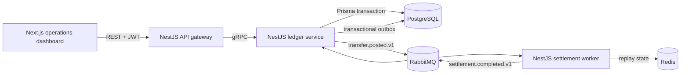

# LedgerFlow — Event-Driven Fintech Platform

LedgerFlow is a local-first financial operations simulator built with Node.js, NestJS, TypeScript, PostgreSQL, Prisma, RabbitMQ, Redis, gRPC, Docker, and Next.js.

It demonstrates how a payment-style backend can remain correct when clients retry commands, workers restart, or events are delivered more than once. **LedgerFlow never connects to a bank or payment gateway and never moves real money.**

## Objective

Build a focused portfolio project that proves senior backend capabilities through working code:

- immutable double-entry journals;
- atomic balance and outbox persistence;
- idempotent commands and event consumers;
- synchronous gRPC and asynchronous RabbitMQ communication;
- a clear operations dashboard for support and reconciliation.

## Problem

A CRUD transfer API can create duplicate charges or inconsistent balances when a request is retried, a database commit succeeds before event publication, or a worker crashes between publishing and acknowledgement. Financial systems also need an audit trail that explains every balance change.

## Solution

LedgerFlow treats each simulated transfer as one balanced journal. The ledger service writes the transfer, postings, balance snapshots, idempotency record, and outbox event in one PostgreSQL transaction. A dispatcher publishes the stored event to RabbitMQ. The settlement worker publishes a deterministic result and saves replay state in Redis before acknowledging the message. The ledger service consumes that result idempotently.

## Architecture



The ledger service is the only PostgreSQL owner. Redis is coordination data, not financial truth.

## What is implemented

- Simulated USD transfers between seeded Alice and Bob wallets.
- Integer minor-unit money (`$25.00` is stored as `2500`), never floating-point ledger amounts.
- Balanced debit and credit postings for every journal.
- Immutable posting history and explicit compensating reversals.
- Request idempotency with payload-conflict detection.
- Transactional outbox with persistent RabbitMQ messages.
- Manual acknowledgement after successful event handling.
- Deterministic settlement result IDs for safe replay.
- Demo JWT authentication, operator authorization, request validation, correlation IDs, and Swagger.
- Separate liveness and dependency-readiness endpoints.
- Responsive, accessible operations dashboard with reduced-motion support.

## Technology

| Area             | Stack                                   |
| ---------------- | --------------------------------------- |
| API and services | Node.js 24, NestJS 12, TypeScript 5.9   |
| Data             | PostgreSQL 17, Prisma 7                 |
| Messaging        | RabbitMQ 4, Redis 8, gRPC               |
| Frontend         | Next.js 16 App Router, React 19, Lucide |
| Quality          | Vitest, Supertest, ESLint, Prettier     |
| Runtime          | Docker Compose                          |

## Repository map

```text
apps/
  api-gateway/         REST, JWT, RBAC, validation, Swagger, gRPC client
  ledger-service/      accounting application service, Prisma, gRPC, outbox
  settlement-worker/   RabbitMQ consumer, Redis replay state, result publisher
  web/                 Next.js operations dashboard
packages/
  contracts/           shared TypeScript types and ledger.proto
  ledger-domain/       pure money, journal, and transfer rules
docs/
  design/              product and architecture specification
  superpowers/plans/   implementation plan and verification scope
```

## Quick start with Docker

### Prerequisites

- Docker Desktop with Compose v2
- 4 GB of free memory for the local stack

```bash
git clone <your-repository-url> ledgerflow
cd ledgerflow
docker compose up --build
```

Open:

- Dashboard: <http://localhost:3000>
- REST API: <http://localhost:3001/api>
- Swagger: <http://localhost:3001/docs>
- RabbitMQ management: <http://localhost:15672> (`ledgerflow` / `ledgerflow`)

The ledger container applies the checked-in Prisma migration and seeds demo accounts before starting gRPC.

Stop the services with `docker compose down`. Add `-v` only when you intentionally want to remove local PostgreSQL and Redis data.

## Run without Docker

Infrastructure still needs PostgreSQL, RabbitMQ, and Redis. Copy the example environment and update connection strings if necessary:

```bash
cp .env.example .env
npm install
npm run db:generate
npm run db:deploy
npm run db:seed
npm run dev
```

On PowerShell, use `Copy-Item .env.example .env` instead of `cp`.

## Demo credentials

```text
Email:    operator@ledgerflow.local
Password: ledgerflow-demo
```

These credentials and the default JWT secret are for local simulation only.

## Demo workflow

1. Open the dashboard and confirm the **Local sandbox** indicator.
2. Sign in through `POST /api/auth/login` or Swagger.
3. Create a `$25.00` transfer from `wallet-alice` to `wallet-bob` with a unique `Idempotency-Key` header.
4. Inspect the journal and verify total debits equal total credits.
5. Watch the settlement change from `PENDING` to `SETTLED`.
6. Replay the exact command and idempotency key; the original transfer is returned.
7. Reuse that key with a different amount; the API rejects the conflict.
8. Reverse the transfer; LedgerFlow creates a new compensating journal rather than editing history.

The dashboard currently includes clearly labeled representative preview data so its UI can be reviewed without infrastructure. The API and services provide the live workflow.

## API example

Get a token:

```bash
curl -X POST http://localhost:3001/api/auth/login \
  -H "Content-Type: application/json" \
  -d '{"email":"operator@ledgerflow.local","password":"ledgerflow-demo"}'
```

Create a transfer after copying `accessToken` from the response:

```bash
curl -X POST http://localhost:3001/api/transactions \
  -H "Authorization: Bearer <accessToken>" \
  -H "Idempotency-Key: demo-transfer-001" \
  -H "Content-Type: application/json" \
  -d '{
    "sourceAccountId":"wallet-alice",
    "destinationAccountId":"wallet-bob",
    "amountMinor":2500,
    "currency":"USD",
    "reference":"Dinner split"
  }'
```

Important routes:

| Method     | Route                           | Purpose                      |
| ---------- | ------------------------------- | ---------------------------- |
| `POST`     | `/api/auth/login`               | Create demo JWT              |
| `GET/POST` | `/api/transactions`             | List or create transfers     |
| `POST`     | `/api/transactions/:id/reverse` | Create compensating reversal |
| `GET`      | `/api/journals/:id`             | Inspect journal postings     |
| `GET`      | `/api/settlements`              | Inspect settlement state     |
| `GET`      | `/api/dashboard/summary`        | Operational metrics          |
| `GET`      | `/health/live`                  | Process liveness             |
| `GET`      | `/health/ready`                 | Ledger dependency readiness  |

## Financial invariants

- Amounts are positive safe integers in minor units.
- The MVP accepts USD only.
- Source and destination accounts must differ.
- Every journal has at least two postings.
- Total debits must equal total credits.
- Posted journals are never edited or deleted.
- Corrections create a linked reversal journal.
- A reused idempotency key must have the same payload.
- Consumer acknowledgement happens only after successful processing.

## Quality checks

```bash
npm run format:check
npm run lint
npm run typecheck
npm test
npm run build
npm audit --audit-level=high
```

Run the same complete gate with `npm run verify`.

Run one workspace while developing:

```bash
npm test -w @ledgerflow/ledger-domain
npm test -w @ledgerflow/ledger-service
npm test -w @ledgerflow/api-gateway
npm test -w @ledgerflow/web
```

## Observability and operations

- `x-correlation-id` is accepted or generated by the gateway and returned to the caller.
- Outbox rows record publication status and attempt count.
- Settlement rows record event ID, attempt count, status, and completion time.
- RabbitMQ messages are persistent and queues are durable.
- Readiness fails when gRPC is unavailable while liveness stays available.

## Security and safety

LedgerFlow is an educational simulator, not a PCI-compliant payment system. Do not connect it to real accounts, store customer secrets, or reuse the demo credentials. Production work would require managed secrets, TLS/mTLS, rate limits, audited authorization, encrypted backups, KYC/AML controls, fraud monitoring, data retention rules, and independent security review.

## Limitations

- USD only; no fees, tax, interest, or foreign exchange.
- One PostgreSQL owner and one settlement worker process.
- Redis replay state is retained for seven days.
- No real payment gateway, bank integration, cloud deployment, or Kubernetes.
- Dashboard preview data is not yet replaced by authenticated live queries.

## Roadmap

- Connect dashboard queries and mutations to the authenticated gateway.
- Add PostgreSQL/Testcontainers integration tests and RabbitMQ contract tests.
- Add dead-letter queues, retry policy, structured JSON logs, and metrics export.
- Add reconciliation reports and operator-controlled retry tooling.
- Add multi-currency journals only after defining FX and rounding invariants.

## License

MIT — see [LICENSE](LICENSE).
