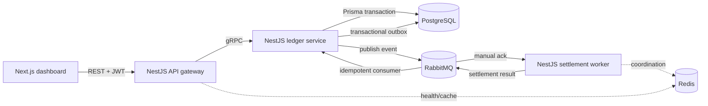

# LedgerFlow MVP Design

## Product intent

LedgerFlow is a local-first financial operations simulator that demonstrates senior Node.js, NestJS, TypeScript, PostgreSQL, Prisma, RabbitMQ, Redis, gRPC, and Docker skills without pretending to move real money. A developer can create simulated transfers, inspect the resulting double-entry journal, watch settlement events, and safely retry the same request.

## Objective

Build a focused portfolio project that proves three hard backend capabilities:

1. correct double-entry accounting,
2. reliable event-driven processing, and
3. an operations dashboard that makes system state easy to understand.

## Problem

Financial systems must remain correct when clients retry requests, workers restart, or messages are delivered more than once. A basic CRUD demo does not show how to prevent duplicate charges, preserve an audit trail, or reconcile asynchronous settlement work.

## Solution

LedgerFlow records every simulated movement as an immutable, balanced journal. The API gateway accepts REST requests and calls the ledger service through gRPC. The ledger service is the only owner of PostgreSQL data. It persists the journal and an outbox event in one transaction. A publisher sends pending outbox events to RabbitMQ, and the settlement worker processes them idempotently. Redis provides short-lived coordination and health data, not financial truth.

## Scope

### Included

- Simulated USD transfers between seeded wallets.
- Integer minor-unit amounts; `$12.34` is stored as `1234`.
- Balanced debit and credit postings.
- Immutable journals and explicit reversals.
- Client idempotency keys and safe event replay.
- Transactional outbox publishing.
- Manual RabbitMQ acknowledgements.
- REST gateway, gRPC ledger boundary, RabbitMQ settlement events.
- Responsive operations dashboard with accessible tables and charts.
- Unit, integration, and end-to-end tests.
- Docker Compose for local infrastructure.

### Not included

- Real payment gateways, bank connections, KYC, PCI compliance, or real money.
- Foreign exchange, fees, interest, tax, or multi-currency journals.
- Cloud deployment, Kubernetes, or service discovery.
- Separate databases for each process. The ledger service owns the single PostgreSQL database.

## Architecture

## Repository shape

- `apps/api-gateway` — public REST API, demo JWT authentication, Swagger, and gRPC client.
- `apps/ledger-service` — domain rules, Prisma persistence, gRPC handlers, outbox publisher, and settlement-result consumer.
- `apps/settlement-worker` — RabbitMQ consumer that simulates settlement and publishes completion.
- `apps/web` — Next.js App Router dashboard.
- `packages/contracts` — transport-neutral TypeScript contracts, event names, and protobuf definitions.
- `packages/ledger-domain` — pure accounting rules with no framework or database dependency.

## Financial rules

- Money is represented as a base-10 integer in minor units.
- Every journal contains at least two postings.
- Total debits equal total credits for the journal currency.
- MVP transfers use USD only.
- A journal cannot be edited or deleted after posting.
- A correction creates a new reversal journal linked to the original.
- An idempotency key identifies one command and returns its original result on retry.
- Event consumers store processed event IDs before acknowledging messages.

## Demo flow

1. Sign in with the documented demo operator account.
2. View seeded Alice and Bob wallet balances.
3. Transfer `$25.00` from Alice to Bob.
4. Open the journal to see equal debit and credit postings.
5. Watch the settlement move from `PENDING` to `SETTLED`.
6. Replay the same idempotency key and confirm no second journal is created.
7. Reverse the transfer and confirm a new compensating journal restores the balances.

## Interface design

The dashboard uses the verified UI/UX Pro Max direction stored in `design-system/ledgerflow/MASTER.md`: dark slate foundations, restrained glass surfaces, green success, amber pending, and red failure states. Fira Sans handles body copy and Fira Code handles identifiers and amounts. Dense financial tables stay opaque for readability. Motion is limited to status transitions and respects reduced-motion preferences.

Primary routes:

- `/` — operational summary, volume trend, service health, and recent activity.
- `/transactions` — searchable transfer list and create-transfer form.
- `/ledger` — journal explorer with debit/credit proof.
- `/settlements` — queue and settlement status.

## Safety and reliability

- The UI and README clearly state that all funds are simulated.
- Credentials are demo-only and loaded from environment variables.
- Validation rejects zero, negative, fractional-minor-unit, non-USD, self-transfer, and insufficient-balance requests.
- Logs use correlation IDs but never include passwords or JWTs.
- Health endpoints distinguish liveness from dependency readiness.

## Definition of done

- `npm test` passes pure domain, service, and API tests.
- `npm run build` succeeds for all applications.
- `docker compose up --build` starts PostgreSQL, RabbitMQ, Redis, the three backend processes, and the web dashboard on a machine with Docker Desktop.
- The documented demo flow works and duplicate delivery never creates a duplicate journal or settlement.
- The dashboard is usable at 375, 768, 1024, and 1440 pixel widths.
- README covers Objective, Problem, Solution, architecture, setup, demo, API, testing, limitations, and roadmap.
