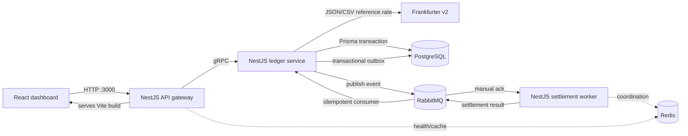

# LedgerFlow MVP Design

## Product intent

LedgerFlow is a local-first financial operations simulator built with Node.js, NestJS, TypeScript, PostgreSQL, Prisma, RabbitMQ, Redis, gRPC, and Docker. It never moves real money. One customer account owns multiple currency balances. An operator can create or fund those balances, transfer one currency to another customer, inspect double-entry journals, watch settlement events, exercise FX through the API, and safely retry the same request.

## Objective

Build a focused system around three backend concerns:

1. correct double-entry accounting,
2. reliable event-driven processing, and
3. an operations dashboard that makes system state easy to understand.

## Problem

Financial systems must remain correct when clients retry requests, workers restart, or messages are delivered more than once. A basic CRUD demo does not show how to prevent duplicate charges, preserve an audit trail, or reconcile asynchronous settlement work.

## Solution

LedgerFlow records every simulated movement as an immutable, balanced journal. The API gateway accepts REST requests and calls the ledger service through gRPC. The ledger service is the only owner of PostgreSQL data. It persists the journal and an outbox event in one transaction. A publisher sends pending outbox events to RabbitMQ, and the settlement worker processes them idempotently. Redis provides short-lived coordination and health data, not financial truth.

## Scope

### Included

- Same-currency transfers between different customer accounts across USD/EUR/GBP/EGP.
- One wallet aggregate per customer with at most one balance per supported currency.
- Admin creation of missing zero-value currency balances and cash-backed top-up of existing balances.
- Synchronous USD/EUR/GBP/EGP wallet conversion from immutable Frankfurter reference-rate quotes.
- Synchronous cash-backed wallet funding with immutable funding history.
- Integer minor-unit amounts; `$12.34` is stored as `1234`.
- Balanced debit and credit postings.
- Immutable journals and explicit reversals.
- Client idempotency keys and safe event replay.
- Transactional outbox publishing.
- Manual RabbitMQ acknowledgements.
- REST gateway, gRPC ledger boundary, RabbitMQ settlement events.
- Responsive operations dashboard with accessible tables and charts.
- Unit, integration, and end-to-end tests.
- Docker Compose for local infrastructure.

### Not included

- Real payment gateways, bank connections, KYC, PCI compliance, or real money.
- Executable trading prices, spreads, FX fees, interest, tax, or currencies outside USD/EUR/GBP/EGP.
- Cloud deployment, Kubernetes, or service discovery.
- Separate databases for each process. The ledger service owns the single PostgreSQL database.

Frankfurter supplies reference rates only. LedgerFlow does not treat them as executable market prices, does not apply a spread, and does not claim real settlement. `FRANKFURTER_BASE_URL` can point to a compatible endpoint for local testing.

## Architecture

## Repository shape

- `apps/api-gateway` — public REST API, demo JWT authentication, Swagger, static dashboard hosting, and gRPC client.
- `apps/ledger-service` — domain rules, Prisma persistence, gRPC handlers, outbox publisher, and settlement-result consumer.
- `apps/settlement-worker` — RabbitMQ consumer that simulates settlement and publishes completion.
- `apps/web` — React/Vite single-page dashboard served by the NestJS gateway.
- `packages/contracts` — transport-neutral TypeScript contracts, event names, and protobuf definitions.
- `packages/ledger-domain` — pure accounting rules with no framework or database dependency.

## Financial rules

- Money is represented as a base-10 integer in minor units.
- Every journal contains at least two postings.
- Total debits equal total credits for each currency represented by a journal.
- Transfers resolve private ledger accounts from public source wallet ID, destination wallet ID, and currency.
- A transfer cannot target its source customer, and both customers must own the selected currency.
- FX provider decimals are parsed as exact integer ratios and converted with integer half-up rounding.
- Quotes persist their provider, effective date, exact rate evidence, calculated output, creation time, and 15-minute expiry before confirmation.
- FX conversion debits the source wallet liability and credits source platform cash, then debits destination platform cash and credits the destination wallet liability in two independently balanced legs.
- Wallet funding debits the Platform Cash asset and credits the selected wallet liability; both normal-side balances increase.
- A journal cannot be edited or deleted after posting.
- A correction creates a new reversal journal linked to the original.
- An idempotency key identifies one command and returns its original result on retry.
- Concurrent requests sharing one idempotency key are serialized before replay detection.
- Event consumers store processed event IDs before acknowledging messages.

## Demo flow

1. Sign in with the documented demo operator account.
2. View Alice's USD/EUR and Bob's USD/GBP balances grouped beneath their customer accounts.
3. In Ledger, create a missing EGP balance and top it up from EGP Platform Cash.
4. In Transactions, select Alice USD and verify only other USD-capable customers appear.
5. Transfer `$25.00` from Alice to Bob and inspect the balanced journal.
6. Watch settlement move from `PENDING` to `SETTLED`.
7. Replay the same idempotency key and confirm no second journal or balance delta is created.
8. Use Swagger for FX conversion or reversal workflows that intentionally have no dedicated dashboard page.

## Interface design

The dashboard uses the verified UI/UX Pro Max direction stored in `design-system/ledgerflow/MASTER.md`: dark slate foundations, restrained glass surfaces, green success, amber pending, and red failure states. Fira Sans handles body copy and Fira Code handles identifiers and amounts. Dense financial tables stay opaque for readability. Motion is limited to status transitions and respects reduced-motion preferences.

Primary routes:

- `/` — operational summary, volume trend, service health, and recent activity.
- `/transactions` — searchable transfer list and create-transfer form.
- `/ledger` — admin currency-balance creation, multi-currency top-up, per-currency metrics, grouped customers, and funding history.
- `/settlements` — queue and settlement status.

## Safety and reliability

- The UI and README clearly state that all funds are simulated.
- Credentials are demo-only and loaded from environment variables.
- Validation rejects zero, negative, fractional-minor-unit, unsupported-currency, self-transfer, missing-currency, and insufficient-balance requests.
- Logs use correlation IDs but never include passwords or JWTs.
- Health endpoints distinguish liveness from dependency readiness.

## Definition of done

- `npm test` passes pure domain, service, and API tests.
- `npm run build` succeeds for all applications.
- `docker compose up --build` starts PostgreSQL, RabbitMQ, Redis, the three backend processes, and the web dashboard on a machine with Docker Desktop.
- The documented demo flow works and duplicate delivery never creates a duplicate journal or settlement.
- The dashboard is usable at 375, 768, 1024, and 1440 pixel widths.
- README covers Objective, Problem, Solution, architecture, setup, demo, API, testing, limitations, and roadmap.
